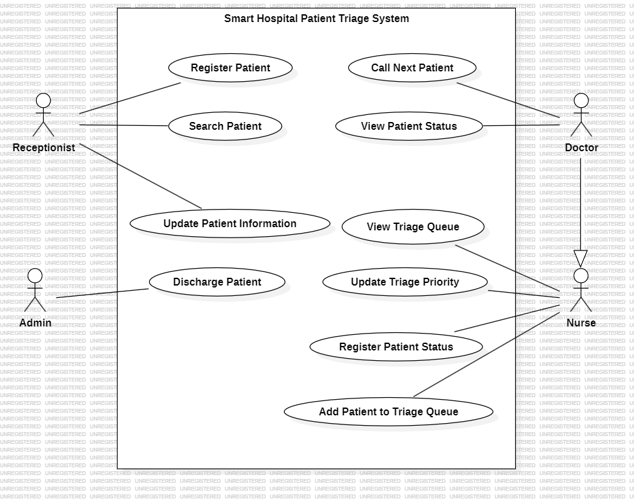
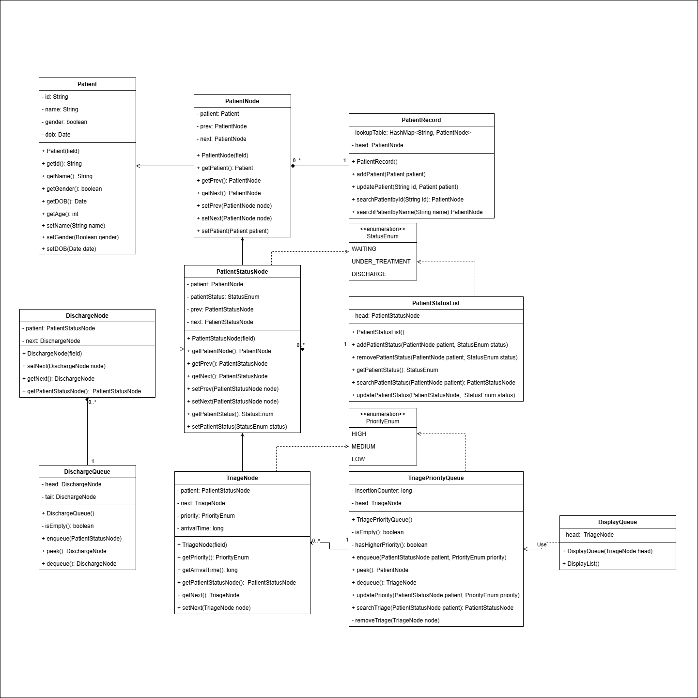
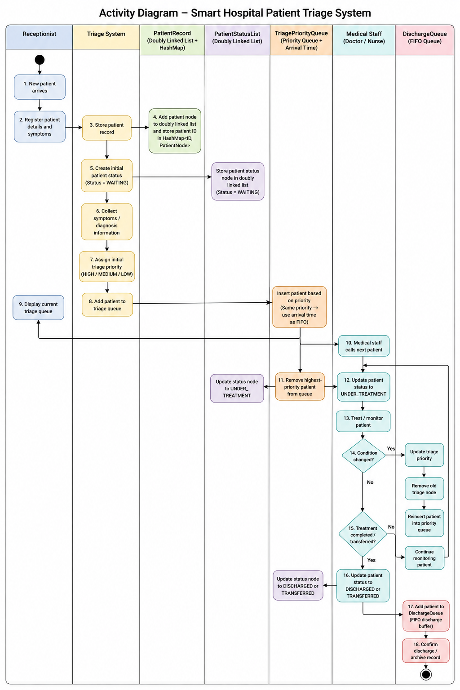
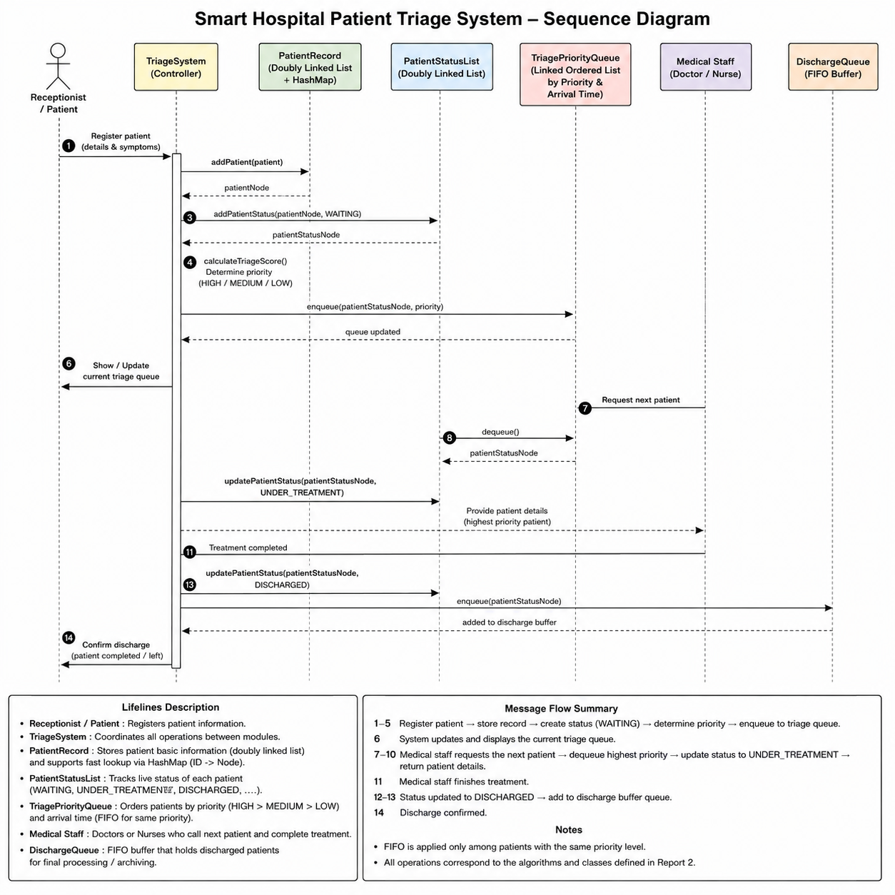

# Smart Hospital Patient Triage System

> A Java project exploring patient record management and priority-based triage queues with custom data structures.

> **Project status:** Prototype for coursework and data-structure study. It is not a production hospital system and must not be used for clinical decisions.

## Overview

The project models patient records and triage-related structures using Java classes, linked lists, a priority queue, and a discharge queue. The repository also includes UML diagrams, a course report, a presentation, and a standalone benchmark comparing two queue designs.

The current application entry point is a small command-line demonstration. It does not provide a user interface or a complete hospital workflow.

## Data structures

- `PatientRecord`: linked patient records with a hash map for ID lookup.
- `PatientStatusList`: linked list of patient status entries.
- `TriagePriorityQueue`: sorted linked-list queue ordered by priority, with arrival order used to break ties.
- `DischargeQueue`: linked queue for discharge entries.

## Requirements

- JDK 8 or later
- Apache Ant (for command-line builds)
- NetBeans (optional; the project includes NetBeans metadata)

## Build and run

From the repository root, build with Ant:

```sh
ant jar
```

Run the generated application JAR:

```sh
java -jar dist/SmartHospitalPatientTriageSystem.jar
```

Alternatively, open the repository root as an existing Java project in NetBeans and use **Run Project**.

## Repository layout

```text
src/                 Java application source
test/                Test source directory (currently empty)
benchmarks/          Standalone queue benchmark and performance graph
docs/diagrams/       UML diagrams
docs/report/         Course report
docs/presentation/   Data structures presentation
nbproject/           Shared NetBeans project configuration
```

## UML diagrams

| Diagram | Preview |
| --- | --- |
| Use case |  |
| Class |  |
| Activity |  |
| Sequence |  |

## Benchmark

`benchmarks/TriageBenchmark.java` is a standalone benchmark comparing a sorted linked-list triage queue with a `TreeMap` of FIFO queues. It generates deterministic workloads at several input sizes, applies priority updates, and reports average timings over five trials. The chart is included as `benchmarks/performance-graph.png`.

Compile and run it from the repository root:

```sh
javac benchmarks/TriageBenchmark.java
java -cp benchmarks TriageBenchmark
```

Benchmark timings depend on the machine and runtime; treat the chart as an experiment result, not a general performance guarantee.

## Limitations

- The entry point only demonstrates a small record operation; a complete interactive triage workflow is not implemented.
- Some operations and edge cases require further implementation and review before the structures can be relied on.
- Patient data and priority handling are illustrative coursework examples, not validated medical logic.

## Academic materials

- [Project report](docs/report/project-report.docx)
- [Data structures presentation](docs/presentation/data-structures-presentation.pptx)

## License

No license has been specified yet. Add a license before allowing reuse of this code.
